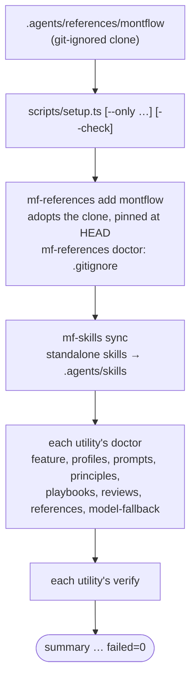

# montflow

Skills, stores and CLIs for agentic development, checked by machines.

## Setup

Everything montflow installs is project-local: a git-ignored checkout at
`.agents/references/montflow`, and stores under `.agents/` that you commit.

### Prerequisites

- `git`
- `bun` 1.3.13, the version montflow pins
- Optional: Nix with flakes, for a dev shell that provides both. See
  [guides/flake.md](guides/flake.md).

### Setup prompt

Paste this into your coding agent (Claude Code, Codex, OpenCode, Pi, Cursor)
from the root of the repository you want to set up:

````text
Set up montflow in this repository. Run every command from the repository
root. Stop at the first failure and show me its output; never work around it.

1. Check that `git` and `bun` are installed and that this is a git
   repository.
2. If `.agents/references/montflow` does not exist, clone montflow there:
   git clone https://github.com/montflow/montflow.git .agents/references/montflow
3. Install its dependencies without its git hooks:
   bun install --cwd .agents/references/montflow --ignore-scripts
4. Run the setup script. It registers the checkout (pinned at its commit),
   git-ignores .agents/references, then installs and verifies every montflow
   utility:
   bun run .agents/references/montflow/scripts/setup.ts
   To install only some utilities, add --only with a comma-separated list
   from: skills, feature, profiles, prompts, principles, playbooks, reviews,
   references, model-fallback. Without --only, install all of them.
5. Read the summary line. It must say failed=0.
6. Add this section to AGENTS.md (create the file if it has none):

   ## montflow
   - CLIs: `bun run --cwd .agents/references/montflow/packages/<pkg> cli <verb> --dir "$PWD"` (mf-skills, mf-feature, mf-principles, mf-playbooks, mf-profiles, mf-prompts, mf-reviews, mf-references).
   - Start rigorous work with `/mf-feature <task>`. Before spawning any subagent, run `mf-feature roles resolve <role>` and follow each seat's `next=`.
   - Re-run or repair the install with the `mf-setup` skill.

7. Show me `git status`, then commit `.gitignore`, `AGENTS.md` and the new
   `.agents/` files in one commit: "chore: set up montflow". Never commit
   `.agents/references/`.
8. Tell me I can choose a harness and model per role with
   `mf-feature roles set` (see .agents/references/montflow/packages/mf-feature/README.md),
   or leave every role on its default.
````

After setup, the `mf-setup` skill re-runs the same script to add a utility,
repair the stores after an update (`--check` reports without writing), or set
up a fresh clone of your repository.

### What the script does



| Utility | Installs | Into |
| --- | --- | --- |
| `skills` | montflow's standalone skills (`mf-skills sync`), plus `mf-skills-create`, `mf-skills-modify`, `mf-skills-sync` | `.agents/skills/` |
| `feature` | the `mf-feature` and `mf-feature-*` skills, the `mf-feature-generic-worker` and `mf-feature-comment-sicko` profiles | `.agents/skills/`, `.agents/@montflow/profiles/` |
| `profiles` | six reviewer profiles (`mf-profiles-bookkeeper`, `mf-profiles-effect-reviewer`, …), `mf-profiles-create`, `mf-profiles-modify` | `.agents/@montflow/profiles/`, `.agents/skills/` |
| `prompts` | `mf-prompts-create`, `mf-prompts-execute` | `.agents/skills/` |
| `principles` | 24 principles | `.agents/@montflow/principles/` |
| `playbooks` | 22 playbooks | `.agents/@montflow/playbooks/` |
| `reviews` | `mf-reviews-adversarial`, `mf-reviews-address` | `.agents/skills/` |
| `references` | `mf-references-add`, `mf-references-find` (montflow itself is always registered) | `.agents/skills/` |
| `model-fallback` | the `mf-model-fallback-setup` prompt (the plugin itself is OpenCode-only) | `.agents/@montflow/prompts/` |

The `mf-*` names are not on your `PATH`. Run each CLI as
`bun run --cwd .agents/references/montflow/packages/<pkg> cli <verb> --dir "$PWD"`,
and wrap the ones you use in `package.json` scripts. To update montflow, see
[guides/updating.md](guides/updating.md), then run the setup script again.

### Standalone and CLI-owned artifacts

Every artifact is one of two kinds:

- **Standalone** skills live in montflow's `.agents/skills/` and work without
  any CLI (`i-have-adhd`, `executing-skills`, `grilling`, …).
  `mf-skills sync` copies these.
- **CLI-owned** artifacts live in the package that needs them, under
  `packages/mf-<cli>/{skills,profiles,prompts,principles,playbooks}`, and are
  named after it (`mf-skills-create`, `mf-profiles-bookkeeper`,
  `mf-feature-arena`). Only that CLI's `doctor` installs them, so a repository
  gets them only when it installs that utility.

### Start a task

```text
/mf-feature fix the flaky retry test in packages/api and open a PR
/mf-feature add a CSV export to the reports page
```

How a task runs, and how to pick the harness and model for each kind of
subagent, is in the [`mf-feature` README](packages/mf-feature/README.md).

## How it works

Every store lives under `.agents/` in your repository. Skills sit in
`.agents/skills/<name>/SKILL.md`. Every other store sits in
`.agents/@montflow/<domain>/`. Each package declares what it ships in
`payload.json`, and its `doctor` installs that payload. `doctor --check`
reports drift without writing. `verify` checks the shape of every file.

mf-feature is a loop an agent runs over those stores:

1. Restate the goal and the smallest change that meets it.
2. Match a playbook (`mf-playbooks list`, `mf-playbooks show <name>`) and copy
   its steps into the todo list.
3. Route work to `mf-feature-*` skills by trigger: architect, swarm, arena,
   interrogate, unslop, no-comments and others.
4. Read each principle it applies (`mf-principles show <name>`) and cite it in
   the reply.
5. Delegate to subagents. `mf-feature roles resolve <role>` says which harness
   and model run each one, and `mf-feature dispatch` runs a seat on another
   harness. Each subagent reads `worker.md` first.
6. Verify, reply in the house style, and finish with the `opening-a-pr`
   playbook.

The [wiki](wiki/index.md) explains mf-feature in full, with diagrams:
[mf-feature](wiki/mf-feature.md).

## CLIs

| CLI | Store | Verbs |
| --- | --- | --- |
| `mf-skills` | `.agents/skills` | `doctor`, `list`, `show`, `verify`, `create`, `modify`, `delete`, `sync`, `version` |
| `mf-prompts` | `.agents/@montflow/prompts` | `doctor`, `list`, `inspect`, `execute`, `show`, `verify`, `render`, `create`, `modify`, `delete`, `version` |
| `mf-profiles` | `.agents/@montflow/profiles` | `doctor`, `list`, `show`, `verify`, `create`, `modify`, `delete`, `version` |
| `mf-reviews` | `.agents/@montflow/reviews` | `doctor`, `list`, `show`, `verify`, `create` (`new`), `resume`, `version` |
| `mf-references` | `.agents/@montflow/references` | `doctor`, `list`, `show`, `verify`, `add`, `update`, `sync`, `status`, `remove`, `version` |
| `mf-principles` | `.agents/@montflow/principles` | `doctor`, `list`, `show`, `verify`, `version` |
| `mf-playbooks` | `.agents/@montflow/playbooks` | `doctor`, `list`, `show`, `verify`, `version` |
| `mf-feature` | `.agents/@montflow/feature/roles.json` (per user, git-ignored) | `roles` (`show`, `set`, `unset`, `verify`, `resolve`), `dispatch`, `version` |
| `mf-model-fallback` | model fallback chains | `status`, `show`, `models`, `set`, `migrate`, `verify`, `doctor`, `remove` |

Each CLI prints its own usage: `bun run --cwd packages/<pkg> cli --help`.
The shared CLI contract is in
[author-mf-utility-cli.md](.agents/documentation/author-mf-utility-cli.md).

## Developing montflow

Read [AGENTS.md](AGENTS.md) first. The main commands:

```bash
bun install
bun run mf:gate:fast   # lint, format, typecheck, every mf check
bun run mf:gate        # the above plus tests, the TUI suite and the smoke
bun run mf:check       # every store and the pstack import check
bun run mf:doctor      # repair every payload package
```

Scope checks to what you touched. `AGENTS.md` lists the per-package forms.

## Acknowledgments

Inspired by:

- [pstack](https://github.com/cursor/plugins/tree/main/pstack) by Lauren Tan (poteto)
- [Effect](https://github.com/effect-ts/effect)
