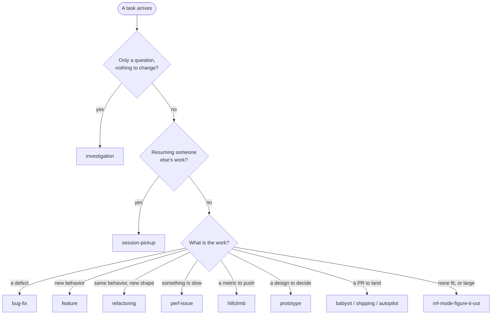
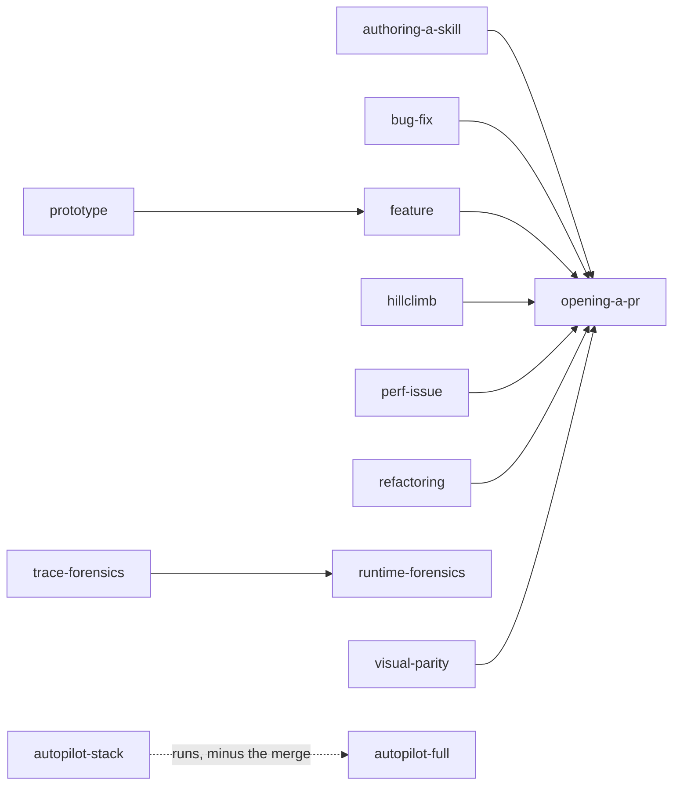
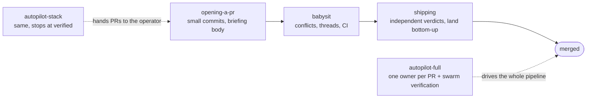
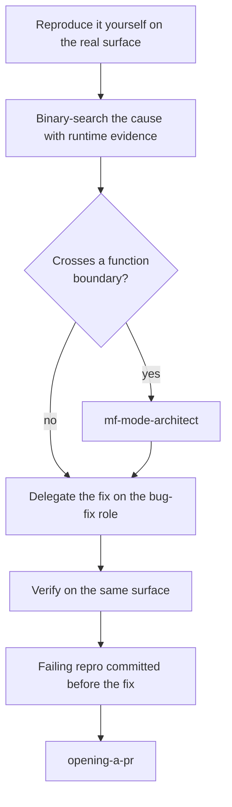

# Playbooks

A playbook is a step list for one kind of task. The agent running `/mf-mode <task>` matches the task to a playbook, copies its steps into its todo list, and works them in order. There are 22 playbooks. Each lives at `packages/mf-mode/playbooks/<name>/PLAYBOOK.md` and is installed into `.agents/@montflow/playbooks/` by `mf-mode doctor`.

```bash
mf-mode playbooks list              # every playbook, one line each
mf-mode playbooks show <name>       # the full steps
mf-mode playbooks verify --all      # shape and references check
```

## Index

### Change code

| Playbook                                | Use it when                                                      |
| --------------------------------------- | ---------------------------------------------------------------- |
| [feature](#feature)                     | New or changed behavior, built from a named data shape           |
| [bug-fix](#bug-fix)                     | Reproduce a defect, root-cause it, and fix with runtime evidence |
| [refactoring](#refactoring)             | A behavior-preserving change to structure or shape               |
| [perf-issue](#perf-issue)               | Trace a measured slowness and improve it against a baseline      |
| [visual-parity](#visual-parity)         | Pixel-exact ui equivalence between two implementations           |
| [authoring-a-skill](#authoring-a-skill) | Writing or editing a SKILL.md                                    |

### Understand before changing

| Playbook                                | Use it when                                                                                                        |
| --------------------------------------- | ------------------------------------------------------------------------------------------------------------------ |
| [investigation](#investigation)         | A read-only question. how does x work, why was y built this way, are we sure                                       |
| [prototype](#prototype)                 | A throwaway sketch to make a design or behavioral decision cheaply, or to settle an empirical fork by observing it |
| [runtime-forensics](#runtime-forensics) | Diagnose a live symptom (leak, idle-cpu spin, glitch) from instrumentation                                         |
| [trace-forensics](#trace-forensics)     | Diagnose a captured profiling artifact (cpuprofile, trace, spindump, heap snapshot)                                |

### Plan, measure, experiment

| Playbook                              | Use it when                                                                                                                                        |
| ------------------------------------- | -------------------------------------------------------------------------------------------------------------------------------------------------- |
| [multi-phase-plan](#multi-phase-plan) | Work that spans phases or stacked PRs                                                                                                              |
| [hillclimb](#hillclimb)               | Sustained, scientific improvement of one metric against a target, looping hypotheses with before/after measurement and one commit per accepted win |
| [eval](#eval)                         | Test how a skill or prompt change affects agent behavior, blinded                                                                                  |

### Run long or unattended

| Playbook                          | Use it when                                               |
| --------------------------------- | --------------------------------------------------------- |
| [autonomous-run](#autonomous-run) | Drive a long task to completion without stopping          |
| [pause-safely](#pause-safely)     | Suspend in-flight work cleanly so it can be resumed later |
| [session-pickup](#session-pickup) | Resume or take over a prior agent's in-flight work        |

### Get a PR merged

| Playbook                            | Use it when                                                                                                                                                      |
| ----------------------------------- | ---------------------------------------------------------------------------------------------------------------------------------------------------------------- |
| [opening-a-pr](#opening-a-pr)       | Open a ready pr from small ordered commits with a conventional commits title and a body that passes mf-mode pr check. invoked at the end of every other playbook |
| [babysit](#babysit)                 | Drive a pr or a stack to merge-ready: conflicts, review threads, ci                                                                                              |
| [shipping](#shipping)               | Independently verify a green stack, then land the contiguous verified run bottom-up through github by default or origin when available                           |
| [autopilot-full](#autopilot-full)   | Run independent prs to merged with one owner per pr. a swarm verifies each code-ready head, and every later change to the patch gets a fresh check               |
| [autopilot-stack](#autopilot-stack) | Autopilot-full without the merge. build and verify prs for the operator to review and land, stacking a pr only on a pr it builds on                              |

### Housekeeping

| Playbook                              | Use it when                                                                                  |
| ------------------------------------- | -------------------------------------------------------------------------------------------- |
| [worktree-cleanup](#worktree-cleanup) | Reclaim disk by pruning merged or abandoned worktrees and stale ios simulators, safety-gated |

## Picking one



Almost every playbook that changes code ends with [opening-a-pr](#opening-a-pr).

## How they connect

An arrow means the playbook's frontmatter lists the other under `playbooks:`. `mf-mode playbooks verify` fails if a listed name does not exist.



## Getting a change merged

Four playbooks form a pipeline, from one PR to a whole queue.



## A representative flow: bug-fix



## The playbooks

### feature

**New or changed behavior.** _You own the design. Plan, review, verify._

Trace the subsystem → `mf-mode-architect` names the data shape → write the throughput checkpoint → delegate the code to a subagent on the `feature` role → verify on the real surface → rebase into small ordered commits → `mf-mode-interrogate` if the design is contested → Opening a PR.

Nothing is built before the data shape is named. A fork you can settle by running something goes to `prototype` instead of a question.

Uses: skill `mf-mode-architect`, skill `mf-mode-arena`, skill `mf-mode-interrogate`, principle `model-the-domain`, principle `sequence-verifiable-units`, principle `separate-before-serializing-shared-state`, playbook [opening-a-pr](#opening-a-pr).

Reply must contain: what you built, what you chose and why, the throughput checkpoint, open decisions. Tables for design alternatives.

### bug-fix

**A defect to reproduce, root-cause and fix.** _You own this task. Plan, review, verify._

Reproduce it yourself on the matching surface → binary-search the cause with runtime evidence → plan the fix (`mf-mode-architect` if it crosses a function boundary) → delegate on the `bug-fix` role → verify on the same surface → stage the failing repro before the fix → Opening a PR.

Every shipped line traces to runtime evidence. A change that "might help" is a hypothesis, not a fix.

Uses: skill `mf-mode-architect`, skill `mf-mode-interrogate`, skill `mf-mode-tdd`, skill `mf-mode-why`, principle `sequence-verifiable-units`, playbook [opening-a-pr](#opening-a-pr).

Reply must contain: what was broken, root cause, fix, how you verified. Paste failing-then-passing repro output verbatim.

### refactoring

**Behavior stays, structure changes.** _You own the contract. The structure changes. The behavior does not._

Pin the behavior contract with a characterization test → name the missing structure → name the target shape → subtract before you add → move in small steps that keep the pin green → prove behavior unchanged on the real artifact → confirm reader load went down → small ordered commits.

If the diff does not lower reader load somewhere, it does not ship.

Uses: skill `mf-mode-architect`, skill `mf-mode-figure-it-out`, principle `model-the-domain`, principle `subtract-before-you-add`, principle `foundational-thinking`, principle `sequence-verifiable-units`, principle `redesign-from-first-principles`, principle `minimize-reader-load`, principle `migrate-callers-then-delete-legacy-apis`, principle `laziness-protocol`, principle `prove-it-works`, playbook [opening-a-pr](#opening-a-pr).

Reply must contain: the structure that changed, the pin you held it against, the equivalence proof, the reader-load delta, what shipped and what got reverted. No new behavior.

### perf-issue

**A measured slowness.** _You own the measurement story. Plan, review, verify the numbers._

Capture and vet a baseline → trace the code to ground hypotheses → plan and delegate the fix on the `perf-issue` role → parse and compare the artifacts → cite the measurement in the PR → Opening a PR.

No perf ceiling is claimed without running it first.

Uses: skill `mf-mode-architect`, skill `mf-mode-benchmark-checklist`, principle `sequence-verifiable-units`, playbook [opening-a-pr](#opening-a-pr).

Reply must contain: baseline number, post-fix number, delta, artifact path.

### visual-parity

**Two implementations must look pixel-identical.** _You own pixel-exact equivalence. The baseline is the spec. You do not touch it._

Establish a visual regression baseline first → hold the anti-shortcut rules (no harness edits, no baseline tampering) → migrate one component at a time, one owner per worktree → image-diff each one → Opening a PR per component or safe batch.

The baseline is the spec and is never edited to make a diff pass.

Uses: principle `separate-before-serializing-shared-state`, playbook [opening-a-pr](#opening-a-pr).

Reply must contain: components migrated, the diff result for each, the baseline harness location, what's left.

### authoring-a-skill

**Writing or editing a `SKILL.md`.** _You own the skill's voice._

Use `mf-skills-create` → validate frontmatter, referenced files and cross-skill links → add tests if structural → Opening a PR.

When in doubt, delete. Keep only prose that changes a decision.

Uses: principle `encode-lessons-in-structure`, playbook [opening-a-pr](#opening-a-pr).

Reply must contain: summary of the skill, key design decisions, validation notes.

### investigation

**A read-only question: how does X work, why was Y built this way, are we sure?** _You own the answer. Plan, route, write._

Trace the code (route motivation questions through `mf-mode-why`) → produce Overview / Key Concepts / How It Works / Where Things Live / Gotchas, or a tradeoffs table for a decision → run `mf-mode-unslop` over the reply.

Changes nothing. If the premise is wrong, say so.

Uses: skill `mf-mode-architect`, skill `mf-mode-unslop`, skill `mf-mode-why`.

Reply must contain: the investigation output. For "are we sure?" answers, include your real judgment with reasons. Push back if the premise is wrong (see Autonomy).

### prototype

**A design or behavioral decision that is cheaper to see than to argue.** _You own the design decision, not the code. The prototype is a throwaway instrument. The real build follows Feature._

Scope the one decision → gather references if the space is open → build throwaway in a scratch dir → put alternatives behind one switcher → verify each on the matching surface → present tradeoffs and a recommendation.

The output is the decision plus a throwaway artifact, never shippable code. The real build follows `feature`.

Uses: skill `mf-mode-architect`, principle `exhaust-the-design-space`, playbook [feature](#feature).

Reply must contain: the variants explored, the evidence (screenshots for a visual decision, the observed output or timing for a behavioral one), tradeoffs, your recommendation, and.

### runtime-forensics

**A live symptom: a leak, an idle-CPU spin, a glitch.** _You own the diagnosis. Instrument the live process, don't theorize from source._

Capture the live signal on the matching surface → reduce it to the smoking gun → prove the mechanism with injected instrumentation → map it back to a source line.

Instrument the running process, do not theorize from source. No fix unless asked.

Uses: principle `guard-the-context-window`.

Reply must contain: the signal captured, the reduced finding, how you proved the mechanism, the source location, artifact paths. No fix unless asked. Hand back to Bug fix or Perf o.

### trace-forensics

**A profiling artifact already exists (cpuprofile, trace, spindump, heap snapshot).** _You own the diagnosis from the artifact._

Identify the format and load it (in a subagent) → transform it into something queryable, such as sqlite → narrow to the cause → attribute it to source → diff a paired capture if you have one.

The artifact is a fixed dataset: read it, do not re-run it. Hands back a diagnosis, not a fix.

Uses: principle `guard-the-context-window`, playbook [runtime-forensics](#runtime-forensics).

Reply must contain: the artifact and format, the reduced finding, the source location, the artifact paths, and whether a paired capture confirmed it.

### multi-phase-plan

**Work that spans phases or stacked PRs.** _You own the plan, not the code. The plan is a checklist an owner runs box by box and the operator audits from the evidence._

Skip the plan if it is one or two files → settle open questions by prototype → write the plan file (PR ids in landing order, dependency graph, a checklist) → every PR needs unit, live and perf boxes checked → hand back the path and stop.

Execution starts only on the operator's explicit go.

Uses: principle `sequence-verifiable-units`.

Reply must contain: the plan path, the PR ids with their dependencies and the review-gated set, and what stays unproven.

### hillclimb

**Sustained improvement of one metric against a target.** _You own the metric and the experiment's integrity. Supervise and review. Delegate the attempts._

Ground the workload and architecture → build and freeze the measurement harness → open a `decision.tsv` log → one hypothesis per iteration with before/after measurement → push past plateaus → stop when the target is met → Opening a PR with accepted wins stacked in order.

One commit per accepted win. Rejected attempts are reverted, never left to ride.

Uses: skill `mf-mode-benchmark-checklist`, skill `mf-mode-show-me-your-work`, principle `guard-the-context-window`, principle `build-the-lever`, principle `sequence-verifiable-units`, principle `laziness-protocol`, principle `prove-it-works`, principle `separate-before-serializing-shared-state`, playbook [opening-a-pr](#opening-a-pr).

Reply must contain: the metric and target, baseline to final with the percent delta, iterations run (kept vs reverted), each accepted fix on one line, the `decision.tsv` path, and .

### eval

**Testing how a skill or prompt change affects agent behavior.** _You own the experiment design. Plan, blind, run, synthesize._

Frame the variant and rubric → set up sanitized environments → write one organic prompt → spawn N candidates on different models → spawn one blinded judge → verify the chain from transcripts, not self-report → read every output yourself and synthesize.

Nothing the candidate sees may hint that it is being tested.

Uses: skill `mf-mode`, skill `mf-mode-arena`.

Reply must contain: variant under test, rubric, per-candidate notes, judge's verdict, your synthesis, and a recommendation for whether to promote the variant.

### autonomous-run

**A long task that should run to completion without stopping.** _You own the exit condition. Define done, then drive to it without stopping._

State a checkable exit condition → pick the wake mechanism (watcher on an event, or a heartbeat) → each iteration makes the smallest justified change and verifies it → handle mid-run discoveries yourself → checkpoint every iteration → stop only when the predicate is met.

A plateau is not a stop, and the predicate is never relaxed to declare victory.

Uses: skill `mf-mode`, skill `mf-mode-show-me-your-work`, principle `sequence-verifiable-units`.

Reply must contain: the exit condition, iterations run, what landed, what was discarded, final predicate state.

### pause-safely

**Suspending in-flight work so it can be resumed later.** _You own a clean stop. Leave a checkpoint a cold-start agent can resume from._

Stop at a safe boundary → take no irreversible action → commit uncommitted edits as one `wip:` commit → write a resume note off-context.

The checkpoint must let a cold-start agent resume.

Reply must contain: where you are in the loop, what's on disk versus still in your head (paths, no diff dumps), the commits you made and whether the tree is clean, and the first ac.

### session-pickup

**Taking over or resuming a prior agent's work.** _You own the resume point. Read the prior trail, don't redo it._

Read the prior trail → diff done versus pending → name the resume point → route the remaining work to the matching playbook → verify inherited claims against the original goal.

Do not redo completed work; a "verify from scratch" pass means you distrust the trail.

Uses: skill `mf-mode`, principle `guard-the-context-window`, principle `prove-it-works`.

Reply must contain: where the prior agent stopped, what you inherited vs redid (ideally nothing redone), the resume point, and the outcome.

### opening-a-pr

**The last step of nearly every other playbook.**

Work from a worktree off trunk → rebase into small landable commits → run `/deslop` → conventional-commits title → a body from `mf-mode pr template` (Summary, What changed, Decisions, Proof, Blast Radius, Verification, Follow-ups), proof attached with `mf-mode pr attach`, no error from `mf-mode pr check` → open the PR ready, not draft.

Opening a PR does not start a babysit.

### babysit

**Driving a PR or stack to merge-ready.** _You own the merge frontier. Declare a mode, clear one PR at a time, stop where the human's call begins._

Declare a mode (`drive`, `threads-only`, `check`) → handle conflicts, then review threads, then CI, in that order → triage bot comments skeptically → stop where the human's call begins.

Never rebases, retargets or force-pushes. A conflict is reported, not resolved. Owner approval is a wait.

### shipping

**Landing a green stack.** _You own what lands. Verify each PR independently, land only the verified run from the root, then keep your hands off the stack._

Resolve the forge → verify each PR independently with an agent that did not write it → land only the contiguous verified run from the bottom → re-check verdicts still match the code (`git patch-id`) → merge bottom-up, one at a time → leave the stack alone while it lands → stop at the ceiling.

Green CI and a bot approval are not verdicts.

Reply must contain: the verified run and its ceiling, each PR's verdict and who produced it, what landed and how you confirmed it, and what the next gap needs.

### autopilot-full

**Many independent PRs to take all the way to merged.** _You own the verdicts, never the PRs. One owner carries each PR from build to merge, and nothing merges until your swarm, which never wrote the code, has proven the code that lands._

Honor the operator's gates → spawn one isolated owner per PR → run owners in parallel off trunk → swarm-verify once at the code-ready head → owners merge only what you verified → run the root layer (countersign gate loosening, hourly audit loop) → stand down on the operator's stop.

You own the verdicts, never the PRs.

Uses: skill `mf-mode-ketchup`, skill `mf-mode-no-comments`, skill `mf-mode-show-me-your-work`, skill `mf-mode-swarm`.

Reply must contain: catch the operator up per the mf-mode-ketchup skill, covering each PR's state and verdict, what merged, countersigns and why, open operator gates, and parke.

### autopilot-stack

**Autopilot-full, but the operator reviews and lands the PRs.** _In place of step 5, stop at verified._

Run `autopilot-full` with two changes: stop at verified instead of merging, and stack a PR only on a PR it builds on.

After the handoff nobody pushes without the operator's go.

Reply must contain: list each PR with its verdict, in place of what merged.

### worktree-cleanup

**Reclaiming disk from merged or abandoned worktrees and stale simulators.**

Snapshot and audit with `scripts/worktree-audit.sh` → treat its buckets as advice and cross-check pinned and active chats → verify usage via transcripts → pause on uncommitted work → prune the confirmed set → reclaim simulators and caches.

The one playbook that deletes user state with no code review to catch a slip, so its gates are the review.

Reply must contain: `df -h /` before and after with space reclaimed, the worktrees pruned, and a one-line reason for each held back (in-use by which chat, or uncommitted work).

## Where playbooks come from

The playbooks are montflow's own and are edited in place. After changing one, run `bun run generate:payload` in `packages/mf-mode` and `bun run mf:doctor` at the root, then `mf-mode verify`.
