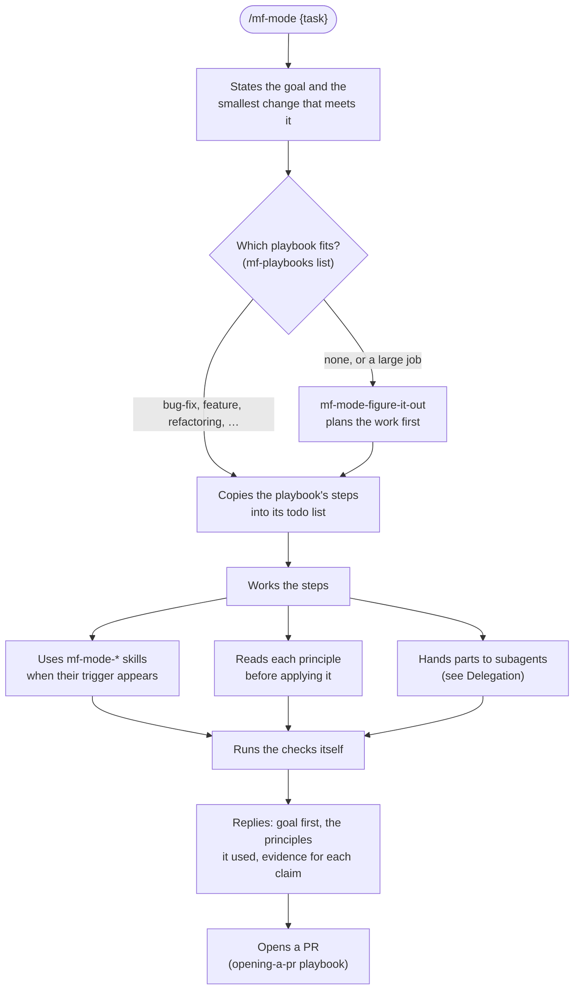
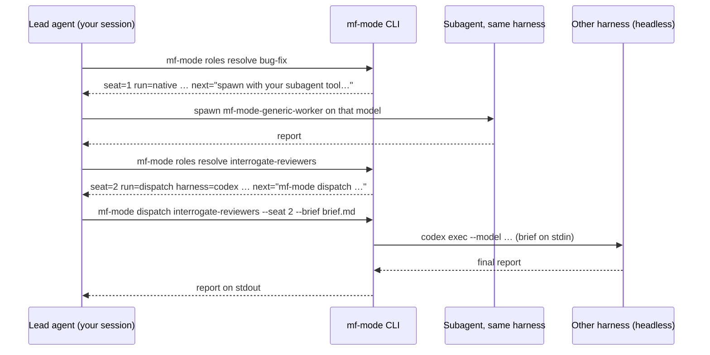
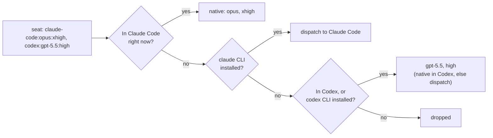

# @montflow/mode

**mf-mode** is a way of working you switch an agent into: `/mf-mode <task>`.
The agent states the goal, picks a playbook, follows its steps, delegates to
subagents, checks its own work, and replies in a fixed format. The text comes
from poteto's [pstack](https://github.com/cursor/plugins/tree/main/pstack)
(Lauren Tan, MIT), imported and renamed by montflow.

This package ships everything mf-mode needs that is not a principle or a
playbook, and the `mf-mode` CLI that makes its mechanical decisions:

| What                                                                | Where it is installed                                    | Installed by        |
| ------------------------------------------------------------------- | -------------------------------------------------------- | ------------------- |
| The `mf-mode` skill and 31 `mf-mode-*` skills                       | `.agents/skills/`                                        | `mf-mode doctor`    |
| `mf-mode-generic-worker`, the subagent every delegating step spawns | `.agents/@montflow/profiles/`                            | `mf-mode doctor`    |
| `mf-mode-comment-sicko`, the comment reviewer                       | `.agents/@montflow/profiles/`                            | `mf-mode doctor`    |
| Your roles: which harness and model run each kind of subagent       | `.agents/@montflow/mode/roles.json` (yours, git-ignored) | `mf-mode roles set` |

Principles and playbooks have their own packages (`mf-principles`,
`mf-playbooks`). Installing montflow with the [setup prompt](../../README.md#setup-prompt)
installs all of them.

## Using it

### 1. Start a task

```text
/mf-mode fix the flaky retry test in packages/api and open a PR
```

Use it for work that needs rigor: a bug you cannot see yet, a feature across
several modules, a refactor, a performance problem. For a one-line edit,
plain prompting is cheaper.

### 2. What the agent does



What you will see:

- **The first message restates the goal.** If it is wrong, correct it there;
  everything after builds on it.
- **A todo list copied from a playbook.** You can follow progress against it.
- **Subagents.** Parts of the work run in parallel or on other models. The
  lead reviews every diff before using it.
- **A reply with evidence.** Each claim is marked measured, inferred, or a
  guess. Principles it applied are named, with the choice each one changed.
- **Few questions.** It makes reversible choices itself and says why. It stops
  for you only before deploys, deleting data, force-pushes, or sending
  messages outside the repository.

### 3. Ask for help

`/mf-mode-help` explains any part of mf-mode, which skill to use for a job,
and how to cut costs.

## Delegation: who runs each subagent

Every delegated step names a **role**, such as `bug-fix` or
`interrogate-reviewers`. A role says which harness (Claude Code, Codex,
OpenCode, Pi) and which model run that kind of subagent. The persona is
always a profile, usually `mf-mode-generic-worker`.

The agent never decides the harness or model itself. It asks the CLI:



- **`native`**: the seat runs on the harness you are already in, so the lead
  spawns it with its own subagent tool.
- **`dispatch`**: the seat runs on another installed harness. `mf-mode
dispatch` starts it headless in the repository and returns its report.
- **`dropped`**: no harness in the seat's list is available. The lead skips it
  and says so.

### The roles

| Role                    | Used for                                            | Seats   |
| ----------------------- | --------------------------------------------------- | ------- |
| `feature`               | Feature and refactoring playbooks                   | 1       |
| `bug-fix`               | Bug fix playbook                                    | 1       |
| `perf-issue`            | Perf playbook                                       | 1       |
| `hillclimb`             | Hillclimb playbook                                  | 1       |
| `judgment`              | Prose and judgment calls                            | 1       |
| `swarm-workers`         | Mechanical edits, swarm workers, every verification | 1       |
| `arena-runners`         | `mf-mode-arena` candidates                          | a panel |
| `arena-judges`          | `mf-mode-arena`'s cross-judge                       | a panel |
| `interrogate-reviewers` | `mf-mode-interrogate` adversaries                   | a panel |

A role you have not set uses the defaults in the `mf-mode` skill on the
harness you are in: the strongest model at high effort, one step lower for
mechanical edits, three vendors for a panel when the harness offers them.

### Choosing harnesses and models

Each **seat** is a list of harness-and-model choices in order of preference.
The first one whose harness is available wins:



Set roles from the repository root (`mf-mode` is
`bun run --cwd .agents/references/montflow/packages/mode cli`):

```bash
# One seat: prefer Claude Code on opus, fall back to Codex
mf-mode roles set bug-fix --seat claude-code:opus:xhigh,codex:gpt-5.5:high

# A panel: one --seat per reviewer, each on a different vendor
mf-mode roles set interrogate-reviewers \
  --seat claude-code:fable:high \
  --seat codex:gpt-5.5:high,opencode:openai/gpt-5.5 \
  --seat opencode:google/gemini-4-neon

mf-mode roles                                   # what is set
mf-mode roles resolve interrogate-reviewers --human   # what would run from here
mf-mode roles unset bug-fix                     # back to the default
```

A choice is `harness:model[:effort]`. `set` refuses one its harness cannot
run, such as `fable` under `codex`, and writes nothing:

| Harness       | Models                                         | Effort                                        |
| ------------- | ---------------------------------------------- | --------------------------------------------- |
| `claude-code` | `opus`, `sonnet`, `haiku`, `fable`, `claude-*` | `low` `medium` `high` `xhigh` `max`           |
| `codex`       | `gpt-*`, `o*`, `codex-*`                       | `minimal` `low` `medium` `high` `xhigh`       |
| `opencode`    | `provider/model`                               | any variant name (sent as `model#variant`)    |
| `pi`          | `provider/model`                               | `off` `minimal` `low` `medium` `high` `xhigh` |

Roles are personal: the file is git-ignored, so each person picks for the
harnesses and subscriptions they have.

## Reference

### Commands

```bash
mf-mode doctor [--check] [--dir <root>]                 # install or check the skills and profiles
mf-mode roles [--human] [--dir <root>]                  # = roles show
mf-mode roles show [--human] [--dir <root>]             # every role: its seats, or `default`
mf-mode roles set <role> --seat <spec> [--seat <spec>…]  # spec: harness:model[:effort],… in preference order
mf-mode roles unset <role>                               # back to the defaults
mf-mode roles verify [--human] [--dir <root>]            # non-zero on any error; no file is valid
mf-mode roles resolve <role> [--harness <h>] [--human] [--verbose]
mf-mode dispatch <role> --seat <n> --brief <file> [--profile <name>|none] [--read-only] [--harness <h>] [--dry-run]
```

`resolve` prints one line per seat. Each ends with `next=`, the one thing to do:

```
$ mf-mode roles resolve interrogate-reviewers
role=interrogate-reviewers source=set current=claude-code seats=3
seat=1 run=native harness=claude-code model=fable effort=high next="spawn with your subagent tool on this model and effort"
seat=2 run=dispatch harness=codex model=gpt-5.5 effort=high next="mf-mode dispatch interrogate-reviewers --seat 2 --brief <file>"
seat=3 run=dropped skipped="pi:google/gemini-4-neon (pi not installed)" next="skip this seat and say so"
```

### The roles file

```json
{
  "version": 1,
  "roles": {
    "bug-fix": [
      [
        { "harness": "claude-code", "model": "opus", "effort": "xhigh" },
        { "harness": "codex", "model": "gpt-5.5", "effort": "high" }
      ]
    ]
  }
}
```

Edit it with `roles set`, never by hand. `verify` fails on unknown roles or
fields, more than one seat outside a panel, and any model or effort its
harness does not take. Nothing resolves from a file with errors.

### Dispatch

`dispatch` resolves the seat itself, so the caller names only the role and the
seat number, never a harness or model. It refuses a `native` or `dropped`
seat and says what to do instead. The worker gets its profile's instructions
(default `mf-mode-generic-worker`) followed by the brief, runs in the
workspace root, and its final report is printed on stdout; the exit code is
the worker's.

| Harness       | Command (`write`)                                                                                         | `--read-only`               |
| ------------- | --------------------------------------------------------------------------------------------------------- | --------------------------- |
| `claude-code` | `claude -p --model M [--effort E] --permission-mode auto` (brief on stdin)                                | `--permission-mode plan`    |
| `codex`       | `codex exec --model M [--config model_reasoning_effort="E"] --sandbox workspace-write -` (brief on stdin) | `--sandbox read-only`       |
| `opencode`    | `opencode run --model M[#E] --auto <brief>`                                                               | `--agent plan`              |
| `pi`          | `pi -p --model M [--thinking E] <brief>`                                                                  | `--tools read,grep,find,ls` |

The child gets `MF_MODE_HARNESS=<harness>`, so a lead nested inside a dispatch
resolves from the right harness.

### Which harness you are in

`--harness` wins. Otherwise `MF_MODE_HARNESS`, then the markers each harness
sets for its commands: `CLAUDECODE` (Claude Code), `CODEX_THREAD_ID` and
`CODEX_SANDBOX*` (Codex), `OPENCODE` (OpenCode). No marker, or markers from two
harnesses, is a refusal that asks for `--harness`: the CLI never guesses.

### Checks

`bun run mf-mode:check` runs `roles verify` and `doctor --check` on this
checkout. The binary test also scans every `mf-mode` skill, playbook,
principle, profile, the harnesses reference and the wiki for
`` `mf-mode <command>` `` and fails on a command this binary does not have.

### Where the files come from

`scripts/import-mfstack.ts` writes `skills/`, `profiles/` and `payload.json`
from the pinned pstack clone; never edit them by hand. See
[wiki/mf-mode.md](../../wiki/mf-mode.md) for the import and the full design.
