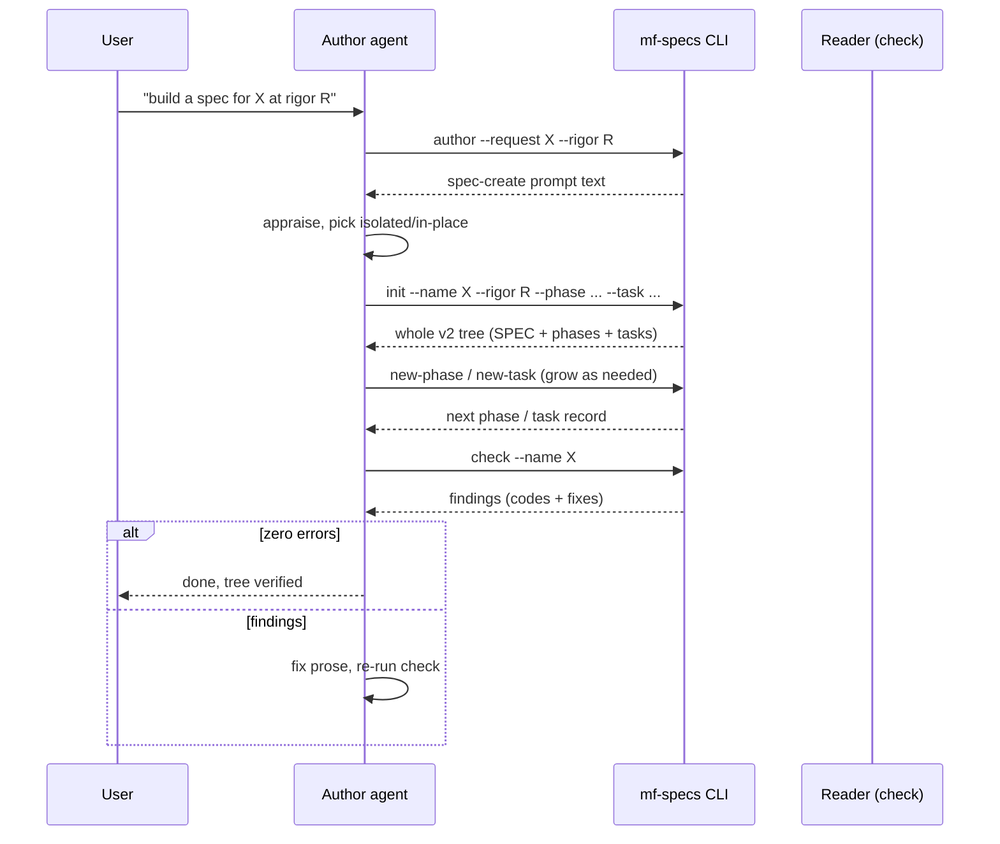
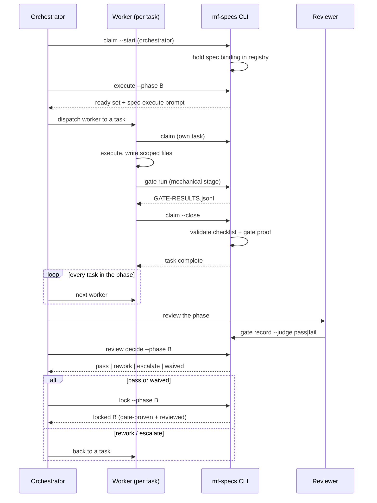

Who holds what pen — the actors and their authority — in 2 minutes.

A spec run is not one agent. It is a small cast: an **author** builds the tree, an **orchestrator** drives it, **workers** execute one [task](./task.md) each, and a **reviewer** passes or blocks a [phase](./phases.md). Authority is encoded in the [claim registry](./verbs.md#claim-authority): the orchestrator holds the spec binding, a worker holds only its own task, and no one else changes a status. The whole run moves a [spec](./specs.md) through its [lifecycle](./lifecycle.md).

## The cast

| Actor            | What it owns                | Verbs it may run                                                                            | It never does                                        |
| ---------------- | --------------------------- | ------------------------------------------------------------------------------------------- | ---------------------------------------------------- |
| **Author**       | creating / growing the tree | `author`, `init`, `create`, `new-phase`, `new-task`, `check`                                | writes a `review` decision or a lock                 |
| **Orchestrator** | the spec binding            | `claim --start/--block/--close`, resetting `--release`, `gate run`, `gate record`, `mail`   | runs a worker's task body                            |
| **Worker**       | one task, once              | `claim` its own task, `claim --release` its own binding                                     | moves a phase or spec status, runs a restricted verb |
| **Reviewer**     | a review series             | `gate record --judge`, `review decide` reads it                                             | changes task or phase status                         |
| **Reader**       | reads only                  | `status`, `state`, `next`, `check`, `resolve`, `sizing`, `models`, `which`, `status-report` | writes any file                                      |

Every surface — binary, `/specs`, host tools, TUI — is one of these roles. A refusal is a coded `claim.not-orchestrator`, `gate.not-orchestrator`, or `mail.not-orchestrator`. The concrete shipped roles are the [profiles](./profiles.md).

## Authoring: who builds the tree

The author writes **prose only** — the full [authoring](./authoring.md) rules apply. The generator owns the frontmatter, the `## Tasks` table, ids, and every status field. The author records the run in `## Creation` and sizes each task by its [size](./sizing.md) — never by hand-writing a status, a `review:` line, or a lock.

## Execution: who works and who proves

A **worker touches only its own task's files** — bounded by the [write-scope](./task.md#write-scope) it declared. The **orchestrator** is the sole caller of the restricted verbs `gate run`, `gate record`, `mail`, and the state-changing `claim --start/--block/--close`; a worker that tries any of these is refused with `claim.not-orchestrator`. `review decide` and `lock` are read-only — they only read and confirm, never gate on authority. The phase locks only when it is **gate-proven and reviewed**, so a worker closing its task can never [lock](./phases.md#the-lock-is-derived) a phase on its own.

## What the readers see

Host tools and the TUI are read-only cast members:

| Host tool      | Role                  | Answers                                         |
| -------------- | --------------------- | ----------------------------------------------- |
| `spec_status`  | reader                | lifecycle, per-phase lock/review, verdict       |
| `spec_models`  | reader                | host catalogue and config findings              |
| `spec_rigor`   | reader                | the chosen rigor and its contract               |
| `spec_sizing`  | reader                | the dispatch target and budget for a task       |
| `spec_author`  | authoring surface     | dispatches the spec-create prompt on a session  |
| `spec_execute` | orchestration surface | dispatches the spec-execute prompt on a session |

The TUI picker reads the same `status` engine and offers only directories holding `SPEC.md`. None of these write a file — every write goes through the generator verbs, and every write is bounded by an actor's authority. The readers and surfaces are the [verbs](./verbs.md); the shipped roles install with [payload](./payload.md).
