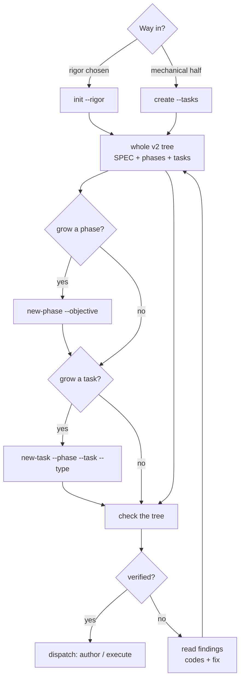
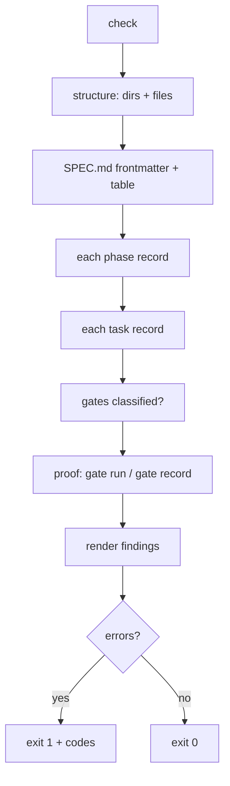

Author a [spec](./specs.md), [phase](./phases.md), or [task](./task.md) — and know how each one is proven — in 3 minutes.

Authoring is the set of [verbs](./verbs.md) that **create or extend** a spec tree. It splits into two ways in (`init` [rigor](./rigor.md)-driven, `create` model-free) and two growth verbs (`new-phase`, `new-task`), plus the `author` / `execute` prompt renderers that drive a worker session. Everything a generator writes is machine-checkable; `mf-specs check` is the gate that proves a tree is well-formed.

## The authoring flow



## Two ways in

`init` and `create` both build a whole spec, but pick by how much you know up front.

| Verb     | Flags                                                                                                                                            | Writes                                                                         | Use when                                                          |
| -------- | ------------------------------------------------------------------------------------------------------------------------------------------------ | ------------------------------------------------------------------------------ | ----------------------------------------------------------------- |
| `init`   | `--name --rigor --author --description --workspace-type` plus repeated `--phase`, `--task`, `--review`, `--review-reason`, `--reviewer-profiles` | a full v2 tree, phases and tasks, the `## Creation` record, and review tasks   | rigor is chosen and the plan is settled                           |
| `create` | `--name --author --description --workspace-type` plus one `--tasks` string, `--reviewer-profiles`                                                | the same tree in one phase (`A`), no `## Creation` record, no auto review task | you want the model-free mechanical half and to grow or size later |

- `init` validates the whole plan against the [rigor contract](./rigor.md) **before writing a file**; a violation is refused with an `init.*` code. When you pass no `--phase`/`--task`, it applies rigor defaults — an exploration-required rigor gets a two-phase plan (`explore` in A, `implement` in B). It auto-generates a `review-phase` task last in every `review: required` phase.
- `create` parses `--tasks` as `name[:type[:gates[:size]]][:scope=path,path]` entries separated by `;`, allocates ids `A001`, `A002`, …, and renders `SPEC.md` plus each phase and task directory. It never appends a review task on its own. Task types are `exploratory | execution | planning | review | interruptor | defect` — see [task](./task.md).

## Grow a phase or task

Once a spec exists, `new-phase` and `new-task` allocate the next id from disk and write one record.

- `new-phase --name <spec> --objective <line> [--review <required|waived|none>] [--review-reason <line>] [--gate <none|mechanical|subjective>] [--gate-judge <slug>] [--board|--no-board]` — allocates the next phase letter (`A`, then `B`, …) and writes `PHASE.md`, `MEMORY.md`, and an optional `BOARD.md` / `GATES.md`.
- `new-task --name <spec> --phase <id> --task <name> --type <type> [--size <size>] [--gates] [--write-scope <paths>] [--depends-on <ids>] [--related-tasks <ids>] [--originator <slug>] [--finding-ref <ref>] [--reviewer-profiles <slugs>] [--requirement <line>]` — allocates the next `NNN` in that phase (`A001`, then `A002`), writes `TASK.md` + `MEMORY.md` (+ `GATES.md` when gated or the type is execution/defect/interruptor), and appends the row to the `SPEC.md` task table.

The id is never guessed by the author. Both verbs read the existing dirs, take the max id, and add one, so two authors cannot collide. Both re-apply the [rigor](./rigor.md) ceilings — `new-phase` refuses a phase past `maxPhases`; `new-task` refuses one past the per-phase task ceiling. Review decisions are set with `mf-specs waiver`, never hand-written.

## The rigor contract

A rigor level is not prose — it is a mechanical constraint table every authoring verb enforces. Pick one of five: `trivial`, `light`, `standard`, `deep`, `critical`. There is no default; a missing value is an error. The full contract is on [rigor](./rigor.md).

| Level      | phases | tasks | tasks/phase | exploration | review   | gate             | waiver       |
| ---------- | ------ | ----- | ----------- | ----------- | -------- | ---------------- | ------------ |
| `trivial`  | 1      | ≤ 2   | ≤ 2         | forbidden   | waived   | command-per-task | permitted    |
| `light`    | 1      | ≤ 4   | ≤ 4         | optional    | waived   | per-task         | permitted    |
| `standard` | 1–2    | ≤ 6   | ≤ 4         | optional    | required | per-task         | records-only |
| `deep`     | 2–3    | ≤ 9   | ≤ 5         | required    | required | phase-and-task   | records-only |
| `critical` | 2–4    | ≤ 12  | ≤ 6         | required    | required | phase-and-task   | forbidden    |

`init`, `new-phase`, `new-task`, `waiver`, and the `rigor` verb all read the same contract, so a phase you grow can never silently exceed the level you set. Violations surface as `init.phase-count`, `init.task-ceiling`, `init.exploration-*`, `init.review-task`, `init.review-reason`, `init.waiver-policy`, and live trees are re-checked with `rigor.ceiling-exceeded`. The rigor is stored in the `## Creation` body section (never frontmatter), parsed as `- rigor: <level>`.

## How it is mechanically verified

`mf-specs check` is the reader that proves a tree is well-formed. It is not a linter opinion — every finding is a coded rule with a `fix`. Two severities: `error` (fails `check`) and `warning` (exits 0 but prints).



What `check` proves, by rule family — the detail lives on [specs](./specs.md), [phases](./phases.md), and [task](./task.md):

- **Structure** — a task dir lives inside its phase (`A001-<name>`), required files exist (`PHASE.md`, `MEMORY.md` at v2), nothing stray in a task dir.
- **SPEC.md** — the task table matches disk: ids unique, `status` and `gates` agree with each `TASK.md`; a version bump lands with its transformation (`spec.version-untransformed`).
- **Task** — id/name/type agree with the directory, a known `type`, `write-scope:` declared on pending work (`task.write-scope-missing` — a warning), size present and valid (`task.missing-size`, `task.size-none-unfinished`).
- **Phase** — id matches the dir, `objective` present, status mirrors the derived task status (`phase.status-stale`), review decision consistent with the review task it holds (`phase.review-none-with-task`, `phase.waiver-with-review-task`).
- **Gates** — a classified mechanical stage needs a passing result before close (`gate.unproven`); no shared phase check copied into a task (`gate.shared-check-in-task`).
- **Version** — `spec-version: 2` current; a missing value reads v1 with `spec.version-outdated` (warning); a future version fails `spec.version-future`.
- **Lifecycle** — a `complete` spec must have every task complete; `--require-complete` adds `spec.incomplete` for any unfinished spec.

Every generator and every reader run the **same** verifier. `create`, `init`, `new-phase`, `new-task`, `claim`, and `check` all call the same `verify` engine, so a tree you can create is a tree you can check.

## Read a check

```bash
mf-specs check --name ship-login          # whole spec
mf-specs check --name ship-login --strict # promote warnings to errors
mf-specs check --name ship-login --verbose# provenance + cause chain
```

Each finding prints `code`, `path`, `field`, `problem`, and `fix` — a machine-readable shape an agent can act on. The [actors](./actors.md) run the authoring and execution flow; the [verifier](./verbs.md#readers) is the same `check` reader the [lifecycle](./lifecycle.md) closes against.
