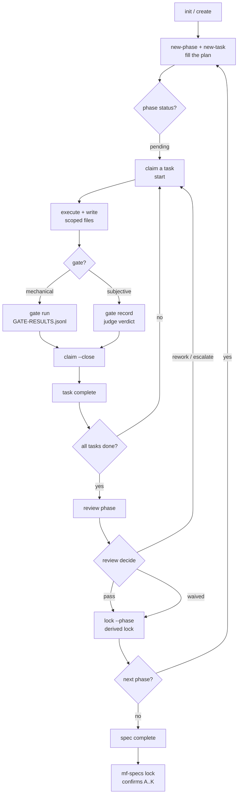

Trace a [spec](./specs.md) from idea to done — and see who drives each step — in 1 minute.

A spec is one planned piece of work. It starts as a tree on disk, gets worked [phase](./phases.md) by phase, and ends `complete` and **locked**. Every transition is a generated record; nothing is typed by hand. The [actors](./actors.md) — the [orchestrator](./actors.md) and the [workers](./actors.md) — drive it through the [verbs](./verbs.md).

## The lifecycle at a glance

## States a spec passes through

| State          | Meaning                                           | Set by                   |
| -------------- | ------------------------------------------------- | ------------------------ |
| `pending`      | idle; no task has started                         | `init` / `new-phase`     |
| `in-progress`  | at least one task started                         | `claim --start`          |
| `blocked`      | work needs a decision or dependency               | `claim --block --reason` |
| `complete`     | every task complete, including review             | the last `review decide` |
| `inconsistent` | the record contradicts itself; repair the records | the verifier             |

`state` is derived, never stored. The verifier reads the [phase](./phases.md) and [task](./task.md) files and computes it; `mf-specs state` prints the one-line form and `mf-specs status` the full panel.

## Drive the lifecycle

The **orchestrator** is the only caller of the state-changing verbs. A [worker](./actors.md) claims one [task](./task.md), executes it, and closes it; it never moves a phase or a spec.

1. **Plan** — [authoring](./authoring.md) `init` / `new-phase` / `new-task` allocate ids and write the `SPEC.md` table and phase/task files.
2. **Execute** — a worker `claim --start`s a task, does the work, and runs its [gates](./task.md#gates).
3. **Prove** — every classified mechanical stage needs a passing `gate run`; a subjective stage needs the judge's `gate record`. A close without proof fails.
4. **Close** — `claim --close` validates the completion checklist and all required gates, then writes `complete` in one temp-then-rename transaction.
5. **Review** — when a phase's tasks are done, `mf-specs review decide` reads the [review](./review.md) store and budget and returns `start`, `pass`, `fix-and-stop`, `rework`, `overflow`, `escalate`, or `waived`.
6. **Lock** — a phase locks when it is gate-proven and reviewed (round closed, waiver effective, or `review: none`). `mf-specs lock` confirms, never writes.

## The lock is a conclusion, not a file

There is no lock file and no stored lock list. A phase is **locked** when two conditions hold at once:

1. **gate-proven** — every classified mechanical stage has a passing result, and
2. **reviewed** — a [review](./review.md) round for that phase is closed, the waiver is effective, or the phase declares `review: none`.

`mf-specs lock --name <spec> --phase <id>` recomputes that conjunction and prints `locked <phase>` at exit 0, or one blocker code per line at exit 1. A `status: complete` spec is frozen — no later edit touches its prose, tree, status, or gates until you migrate it deliberately.
