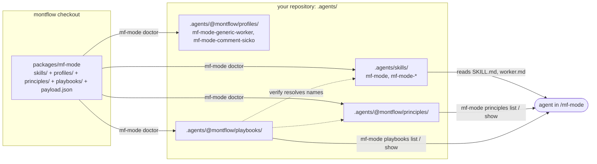
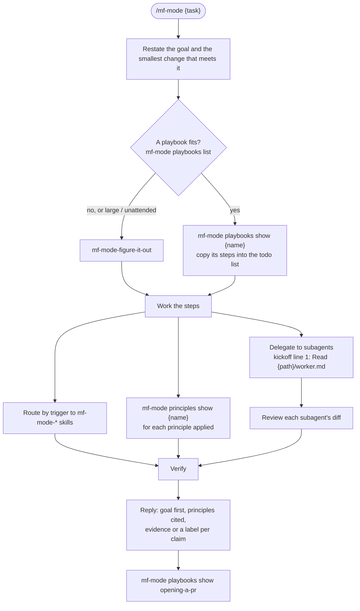
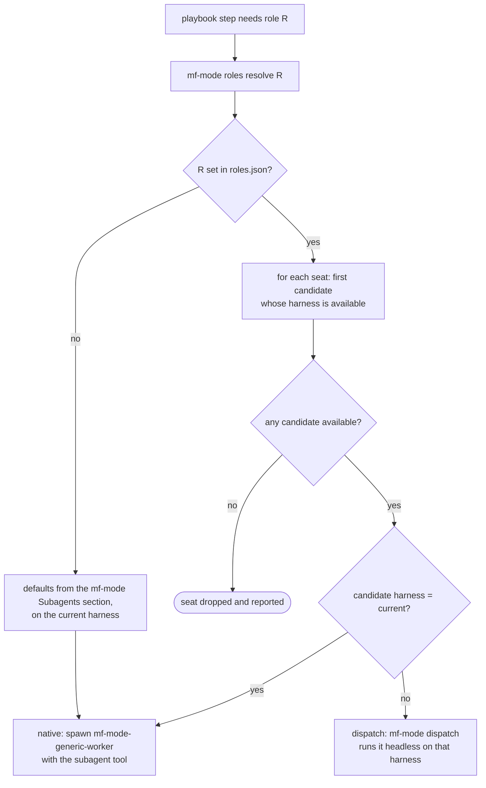

Learn how mf-mode runs a task in 10 minutes: its pieces, its loop, and where each file comes from.

mf-mode is an agent style. You start it with `/mf-mode <task>`. The agent then works in a fixed way: it states the goal, picks a playbook, routes parts of the work to skills, reads the principles it applies, delegates to subagents, verifies, and replies in a set format.

The text comes from poteto's [pstack](https://github.com/cursor/plugins/tree/main/pstack) (Lauren Tan, MIT). montflow forked it into the `mf-` namespace and now maintains it as its own. See [Origin](#origin).

## The pieces

| Piece | What it is | On disk | Read with |
| --- | --- | --- | --- |
| Entry skill | `mf-mode`: the non-negotiables, the principle index, autonomy rules, subagent rules, the reply style, the playbook list | `.agents/skills/mf-mode/SKILL.md` | `/mf-mode` |
| Worker brief | The rules every subagent follows, whatever its kickoff says | `.agents/skills/mf-mode/worker.md` | first line of each kickoff |
| Routed skills | 31 `mf-mode-*` skills: architect, swarm, arena, interrogate, unslop, no-comments, technical-writing, figure-it-out, how, why and more | `.agents/skills/mf-mode-<name>/SKILL.md` | `/mf-mode-<name>` or a trigger |
| Principles | 24 short rules, each with when it applies | `.agents/@montflow/principles/<name>/PRINCIPLE.md` | `mf-mode principles list`, `mf-mode principles show <name>` |
| Playbooks | 22 step lists for kinds of task, each naming the skills, principles and playbooks it uses | `.agents/@montflow/playbooks/<name>/PLAYBOOK.md` | `mf-mode playbooks list`, `mf-mode playbooks show <name>` |
| Profiles | `mf-mode-generic-worker` (the generic worker every delegating step spawns) and `mf-mode-comment-sicko` (the comment reviewer) | `.agents/@montflow/profiles/<name>/PROFILE.md` | `mf-profiles show <name>` |
| Roles | Which harness and model run each kind of subagent, as ordered preferences per seat | `.agents/@montflow/mode/roles.json`, git-ignored | `mf-mode roles`, `mf-mode roles resolve <role>` |
| Helper scripts | pstack's scripts, such as `watch-pr` and `worktree-audit.sh` | `.agents/skills/mf-mode/scripts/` | the skills that name them |

Skills are plain files in the skill store. Principles and playbooks each have their own store and their own `mf-mode` subcommand, so an agent can list them by one line each and read only the ones it needs.

## How the stores fit together



- The mode package ships the `mf-mode` and `mf-mode-*` skills, both profiles, the principles and the playbooks; one `mf-mode doctor` installs them all. `mf-skills sync` copies only standalone skills: it skips every skill a package lists in its `payload.json`.
- `doctor` installs what the package's `payload.json` lists, nested folders such as a skill's `references/` and `scripts/` included. `doctor --check` reports drift and writes nothing.
- `mf-mode playbooks verify` fails when a playbook names a skill, principle or playbook that is not installed. Sync the skills before you verify the playbooks.
- In a repository that uses montflow, the `mf-*` names are not on `PATH`. Run them as `bun run --cwd <checkout>/packages/<pkg> cli <verb> --dir "$PWD"`. An agent can also read the store file directly.

## The lifecycle of a task



1. **Goal.** The first message restates the goal and the smallest change that meets it. Every subagent brief, PR `## Why` and final report opens with the same goal.
2. **Playbook.** The agent matches the task to a playbook and copies its steps into the todo list. No fit, or large, cross-cutting or unattended work, goes to `mf-mode-figure-it-out`.
3. **Work.** The agent follows the steps. It routes parts to skills, reads principles before applying them, and delegates.
4. **Verify.** The agent runs the checks itself. It never hands the human a check it could run.
5. **Reply.** Short declarative sentences. Each claim carries evidence or a label: measured, inferred, or guess.
6. **Open a PR.** `opening-a-pr` is invoked at the end of every other playbook.

## Routing

The entry skill maps triggers to skills. The agent loads a skill when its trigger appears in the work.

| Trigger | Skill |
| --- | --- |
| Code across a function boundary | `mf-mode-architect` |
| Fan-out work | `mf-mode-swarm` |
| A bakeoff between approaches | `mf-mode-arena` |
| A contested design | `mf-mode-interrogate` |
| Any prose, the reply included | `mf-mode-unslop` |
| Docs, PR descriptions, commit messages | `mf-mode-technical-writing` |
| Before review | `mf-mode-no-comments` |
| A number you measured | `mf-mode-benchmark-checklist` |
| Long or unattended work | `mf-mode-show-me-your-work` |
| No playbook fits | `mf-mode-figure-it-out` |

Before any code, the agent names the data shape. A fork it could settle by running something gets a prototype (`mf-mode playbooks show prototype`), not a question.

## Principles

The entry skill lists every principle under five headings: Core, Architecture, Verification, Delegation and Meta. Each entry says when it applies, for example "Laziness Protocol. Refactoring, sizing a diff, or tempted to add abstractions".

The rules for using one:

1. Find it in the index, or with `mf-mode principles list`. The name is the title in kebab case: `laziness-protocol`.
2. Read it in full with `mf-mode principles show laziness-protocol` before applying it.
3. In the reply, name the principle and the specific choice it changed.
4. Cite only principles read in this session.

## Playbooks

A playbook is a step list for one kind of task: `investigation`, `bug-fix`, `perf-issue`, `feature`, `refactoring`, `prototype`, `babysit`, `shipping`, `autonomous-run`, `session-pickup`, `opening-a-pr` and others. `mf-mode playbooks list` prints each with what it is for.

Each `PLAYBOOK.md` starts with frontmatter that names what it uses:

```yaml
---
name: feature
description: "New or changed behavior, built from a named data shape."
skills:
  - mf-mode-architect
  - mf-mode-arena
  - mf-mode-interrogate
principles:
  - model-the-domain
  - sequence-verifiable-units
  - separate-before-serializing-shared-state
playbooks:
  - opening-a-pr
---
```

The agent copies the numbered steps into its todo list and works them in order. `mf-mode playbooks verify` checks that every name in the frontmatter exists in the workspace.

## Subagents

The chat that receives `/mf-mode` runs the playbook and owns every subagent's work.

- **Kickoff.** The first line of every kickoff is `Read <path>/worker.md before anything else.`, with `<path>` the absolute folder of the `mf-mode` skill. The rest is the goal and the task.
- **Worker brief.** `worker.md` holds the rules a subagent needs: the kickoff's bar is the whole bar, never call a tool that asks a person a question, make any reversible choice and say why, stop only for deploys, deleted data, force-pushes or outside messages, and the PR title and body format.
- **Fresh by default.** A fix round, retry or follow-up goes to a new subagent with the original brief and the prior report. Resume one only when its state is costly to move.
- **Review.** The lead reviews each diff and writes its own summary.
- **Profiles and roles.** Delegated work runs as the `mf-mode-generic-worker` profile, on the harness and model that `mf-mode roles resolve <role>` returns. See [Agents and roles](#agents-and-roles).
- **Harnesses.** The text names concepts (spawn a subagent, ask a structured question, keep a todo list, loop until a check passes). [`references/harnesses.md`](../.agents/skills/mf-mode/references/harnesses.md) maps each concept to Claude Code, Codex, OpenCode, Pi and Cursor, and says what to do when a harness lacks it.

## Agents and roles

pstack answers two separate questions when a playbook step spawns a subagent. montflow keeps them separate.

| Question | pstack | montflow | Where it lives |
| --- | --- | --- | --- |
| **Who** is the subagent: how it behaves, what it reads first | an *agent* (`poteto-agent`, `comment-sicko`) | a *profile* | `.agents/@montflow/profiles/<name>/PROFILE.md`, shipped and installed by `mf-profiles doctor` |
| **Which harness and model** run it | a *role* (`bug-fix`, `swarm workers`, …) in a per-user Cursor rule written by `/setup-pstack` | a *role* in a per-user roles file | `.agents/@montflow/mode/roles.json`, git-ignored, managed by `mf-mode roles` |

So the Bug fix playbook's step 3 means: spawn the `mf-mode-generic-worker` profile on whatever the `bug-fix` role resolves to.

### Agents are profiles

| Profile | From pstack | What it does |
| --- | --- | --- |
| `mf-mode-generic-worker` | `poteto-agent` | The generic worker. Every playbook step that delegates code-writing or helper work spawns it. It reads the `mf-mode` skill and `worker.md` first, and reads each principle it applies with `mf-mode principles show`. |
| `mf-mode-comment-sicko` | `comment-sicko` | The comment reviewer `mf-mode-no-comments` spawns. It deletes every comment outside a short keep list and flags the code that needed a comment as `MUST KILL`. It never writes application code. |

Both live in `packages/mf-mode/profiles/`, and `mf-mode doctor` installs them. Each started from a pstack agent file: its body is `## Instructions`, and a short `## Review Checklist` restates the agent's own rules. Neither pins a model: the role decides that.

A role is not a profile. A role holds no instructions, the same persona runs under almost every role, and its model choice is per user and per harness. Shipping roles as profiles would copy the generic worker's instructions into nine files, and `doctor` would overwrite a user's model choice on the next repair.

### Roles

There are nine roles:

| Role | Used for |
| --- | --- |
| `feature` | Feature and Refactoring playbooks |
| `bug-fix` | Bug fix playbook |
| `perf-issue` | Perf playbook |
| `hillclimb` | Hillclimb playbook |
| `judgment` | Prose and judgment calls |
| `swarm-workers` | Trivial mechanical edits, swarm workers, and every verification |
| `arena-runners` | `mf-mode-arena` candidates (a panel) |
| `arena-judges` | `mf-mode-arena`'s cross-judge (a panel the judge is picked from) |
| `interrogate-reviewers` | `mf-mode-interrogate` adversaries (a panel) |

A role is a list of **seats**. A single role has one seat, a panel has several. Each seat is an **ordered list of candidates**, and a candidate is a harness plus a model and an optional effort. The first candidate whose harness is available wins.

```jsonc
// .agents/@montflow/mode/roles.json (git-ignored, per user)
{
  "version": 1,
  "roles": {
    "bug-fix": [
      [
        { "harness": "claude-code", "model": "opus", "effort": "xhigh" },
        { "harness": "codex", "model": "gpt-5.5", "effort": "high" }
      ]
    ],
    "interrogate-reviewers": [
      [{ "harness": "claude-code", "model": "fable", "effort": "high" }],
      [
        { "harness": "codex", "model": "gpt-5.5", "effort": "high" },
        { "harness": "opencode", "model": "openai/gpt-5.5" }
      ],
      [{ "harness": "opencode", "model": "google/gemini-4-neon" }]
    ]
  }
}
```

A harness is **available** when it is the harness the session runs in, or when its CLI (`claude`, `codex`, `opencode`, `pi`) is installed. A seat that resolves to the current harness runs **natively**: the lead spawns it with its own subagent tool. A seat that resolves to another harness is **dispatched**: `mf-mode dispatch` runs it there headless (`claude -p`, `codex exec`, `opencode run`) and returns its report.

The lead never picks a harness itself. It asks the CLI, and does what each seat line's `next=` says:

```
$ mf-mode roles resolve interrogate-reviewers
role=interrogate-reviewers source=set current=claude-code seats=3
seat=1 run=native harness=claude-code model=fable effort=high next="spawn with your subagent tool on this model and effort"
seat=2 run=dispatch harness=codex model=gpt-5.5 effort=high next="mf-mode dispatch interrogate-reviewers --seat 2 --brief <file>"
seat=3 run=dropped skipped="pi:google/gemini-4-neon (pi not installed)" next="skip this seat and say so"
```



- **Unset roles.** A role that is not in the file resolves to the defaults in the Subagents section of the `mf-mode` skill, on the current harness. Those defaults name no vendor or model id: the strongest model at high effort, one step lower for trivial edits, three vendors for a panel when the harness offers them.
- **Dropped seats.** A seat with no available candidate is dropped and reported. A panel keeps going with the seats it has (arena needs at least two runners).
- **Invalid combinations.** `mf-mode roles verify` checks every candidate against what its harness accepts. Claude Code takes `opus`, `sonnet`, `haiku` or `fable` plus an effort. Codex takes OpenAI models only, so `fable` under `codex` is an error. OpenCode takes `provider/model`. A bad combination fails before anything runs.
- **Setting roles.** `mf-mode roles set <role> --seat <spec>` writes the file, replacing pstack's `/setup-pstack`. A spec is the seat's candidates in preference order, `harness:model[:effort]`, comma-separated; repeat `--seat` for each seat of a panel. `mf-mode roles` shows what is set, in the same spec form, and `mf-mode roles unset <role>` goes back to the defaults.
- **OpenCode extra.** The OpenCode `model-fallback` plugin, which switches models on quota errors, can later read the same file to build its fallback chains. That stays OpenCode-only; the roles file does not depend on it.

### The mf-mode CLI

`packages/mf-mode` ships `mf-mode`. It owns every mechanical decision about roles, so the skill text only says "run this and do what it prints". It also ships the skills, profiles, principles and playbooks (`mf-mode doctor`) and reads the principle and playbook stores (`mf-mode principles`, `mf-mode playbooks`). The roles file is per user.

| Command | What it does |
| --- | --- |
| `mf-mode roles` (or `roles show`) | Every role: `<role>: default`, or its seats as specs, seats split by ` \| ` |
| `mf-mode roles set <role> --seat <spec>…` | Writes one role. Refuses, and writes nothing, when `verify` would fail |
| `mf-mode roles unset <role>` | Removes one role, so it resolves to the defaults |
| `mf-mode verify` | Verifies roles, principles and playbooks in one run. Non-zero on any error |
| `mf-mode roles verify` | Checks the file. Non-zero on any error. No file is valid |
| `mf-mode roles resolve <role>` | One `key=value` line per seat, each ending in `next=` |
| `mf-mode dispatch <role> --seat <n> --brief <file>` | Runs a dispatch seat headless and prints its report |

How the CLI keeps agents from guessing:

- **It tells the harness itself.** `--harness` wins, then `MF_MODE_HARNESS`, then the environment markers Claude Code (`CLAUDECODE`), Codex (`CODEX_THREAD_ID`, `CODEX_SANDBOX*`) and OpenCode (`OPENCODE`) set for the commands they run. No marker, or markers from two harnesses, is a refusal that asks for `--harness`. It never guesses.
- **Every seat line names its next step.** `next=` is a spawn instruction, the exact `mf-mode dispatch` command, or "skip this seat and say so".
- **`dispatch` takes a role and a seat number, never a harness or model.** It resolves the seat itself, so a lead cannot dispatch to the wrong harness. It refuses a `native` or `dropped` seat and says what to do instead.
- **Nothing resolves from a bad file.** `resolve`, `show`, `set` and `dispatch` refuse a file with errors and point at `roles verify`.
- **The text cannot drift from the CLI.** The package's binary test scans every `mf-mode` skill, playbook, principle, profile, the harnesses reference and this page for `` `mf-mode <command>` ``, and fails on a command the binary does not have.

What `dispatch` runs, from the workspace root, with `MF_MODE_HARNESS=<harness>` set in the child so a lead nested inside it resolves correctly:

| Harness | Command | `--read-only` |
| --- | --- | --- |
| `claude-code` | `claude -p --model M [--effort E] --permission-mode auto`, brief on stdin | `--permission-mode plan` |
| `codex` | `codex exec --model M [--config model_reasoning_effort="E"] --sandbox workspace-write -`, brief on stdin | `--sandbox read-only` |
| `opencode` | `opencode run --model M[#E] --auto <brief>` | `--agent plan` |
| `pi` | `pi -p --model M [--thinking E] <brief>` | `--tools read,grep,find,ls` |

The brief is the profile's instructions (default `mf-mode-generic-worker`, `--profile none` for none), then the kickoff. `--dry-run` prints the command without running it. The Claude Code, Codex and OpenCode commands were run against their real CLIs; the Pi command follows its documented flags and has not been run.

`bun run mf-mode:check` runs `mf-mode verify` (roles, principles and playbooks) and `doctor --check` on this checkout, and is part of `mf:check` and the CI matrix.

## Origin

mf-mode started as a fork of poteto's [pstack](https://github.com/cursor/plugins/tree/main/pstack) 0.15.46 (Lauren Tan, MIT), at cursor/plugins commit `7a583913`. The fork renamed it into the `mf-` namespace, made the harness wording neutral, turned pstack's agents into profiles and its model roles into `mf-mode roles`. montflow now edits this text directly and does not track upstream. The MIT notice ships as `LICENSE-pstack` in `packages/mf-mode`, the `mf-mode` skill, `packages/mf-mode` and `packages/mf-mode`.

Edit the sources under `packages/mf-mode/` (`skills/`, `profiles/`, `principles/`, `playbooks/`), run its `generate:payload`, then `bun run mf:doctor`.

## Planned

Not built yet:

- **pstack's scripts in `mf-mode`.** watch-pr, the worktree audit, the decision log and the statechart, ported to Effect as `mf-mode` commands.
- **Harness adapters.** Only where a harness needs one: OpenCode, Pi, Claude Code, Codex. The goal is harness-agnostic text plus CLIs.

The `opening-a-pr` playbook still mentions `/deslop`, which montflow does not ship.

## See also

- [README](../README.md) to add montflow to a repository.
- [Skills storage](../packages/mf-skills/wiki/storage.md) for the skill store layout.
- [Updating](../guides/updating.md) to re-sync an installed skill store.
- [`mf-mode` SKILL.md](../.agents/skills/mf-mode/SKILL.md) and [worker.md](../.agents/skills/mf-mode/worker.md), the source of every rule above.
