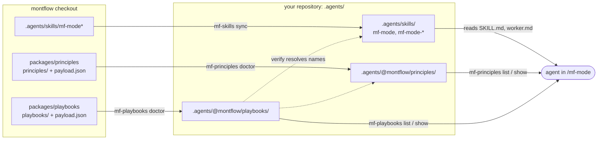
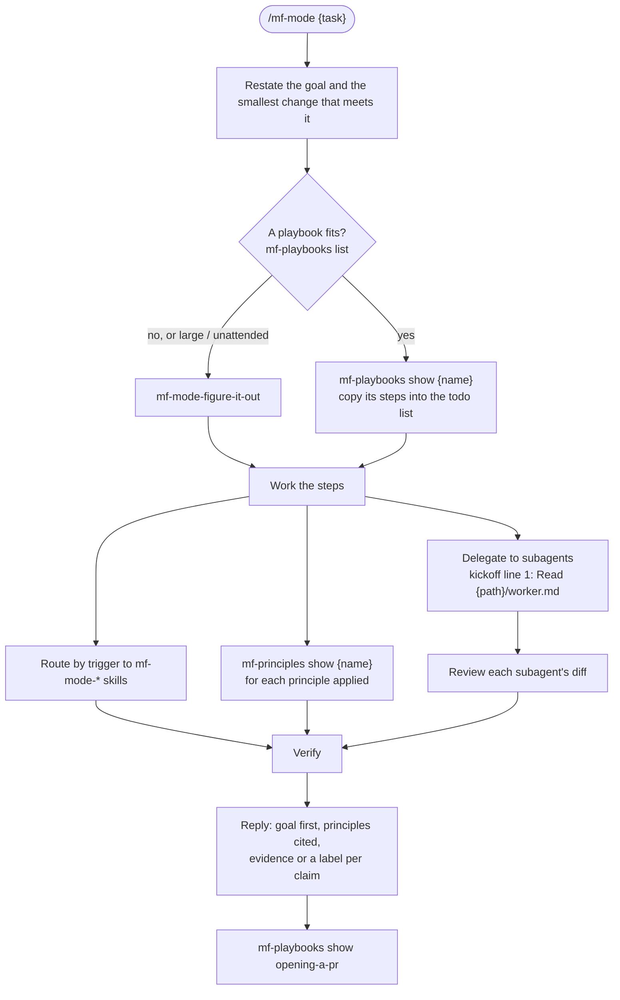
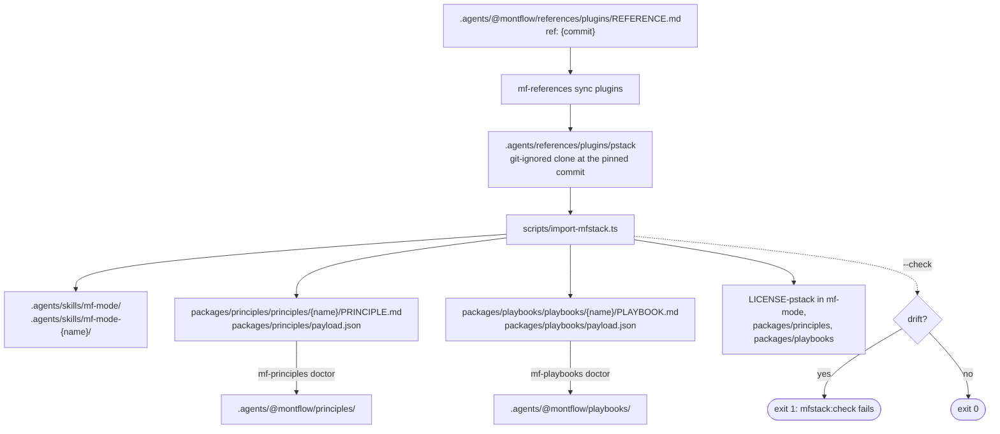

Learn how mf-mode runs a task in 10 minutes: its pieces, its loop, and where each file comes from.

mf-mode is an agent style. You start it with `/mf-mode <task>`. The agent then works in a fixed way: it states the goal, picks a playbook, routes parts of the work to skills, reads the principles it applies, delegates to subagents, verifies, and replies in a set format.

The text comes from poteto's [pstack](https://github.com/cursor/plugins/tree/main/pstack) (Lauren Tan, MIT). montflow imports it, renames it into the `mf-` namespace, and calls the result **mfstack**. Every word of it is generated by `scripts/import-mfstack.ts`. See [The import](#the-import).

## The pieces

| Piece | What it is | On disk | Read with |
| --- | --- | --- | --- |
| Entry skill | `mf-mode`: the non-negotiables, the principle index, autonomy rules, subagent rules, the reply style, the playbook list | `.agents/skills/mf-mode/SKILL.md` | `/mf-mode` |
| Worker brief | The rules every subagent follows, whatever its kickoff says | `.agents/skills/mf-mode/worker.md` | first line of each kickoff |
| Routed skills | 31 `mf-mode-*` skills: architect, swarm, arena, interrogate, unslop, no-comments, technical-writing, figure-it-out, how, why and more | `.agents/skills/mf-mode-<name>/SKILL.md` | `/mf-mode-<name>` or a trigger |
| Principles | 24 short rules, each with when it applies | `.agents/@montflow/principles/<name>/PRINCIPLE.md` | `mf-principles list`, `mf-principles show <name>` |
| Playbooks | 22 step lists for kinds of task, each naming the skills, principles and playbooks it uses | `.agents/@montflow/playbooks/<name>/PLAYBOOK.md` | `mf-playbooks list`, `mf-playbooks show <name>` |
| Helper scripts | pstack's scripts, such as `watch-pr` and `worktree-audit.sh` | `.agents/skills/mf-mode/scripts/` | the skills that name them |

Skills are plain files in the skill store. Principles and playbooks each have their own store and CLI, so an agent can list them by one line each and read only the ones it needs.

## How the stores fit together



- `mf-skills sync --source <checkout> --target <repo>` copies every public skill, `mf-mode` and the `mf-mode-*` skills included.
- Each package's `doctor` installs what its `payload.json` lists. `doctor --check` reports drift and writes nothing.
- `mf-playbooks verify` fails when a playbook names a skill, principle or playbook that is not installed. Sync the skills before you verify the playbooks.
- In a repository that uses montflow, the `mf-*` names are not on `PATH`. Run them as `bun run --cwd <checkout>/packages/<pkg> cli <verb> --dir "$PWD"`. An agent can also read the store file directly.

## The lifecycle of a task



1. **Goal.** The first message restates the goal and the smallest change that meets it. Every subagent brief, PR `## Why` and final report opens with the same goal.
2. **Playbook.** The agent matches the task to a playbook and copies its steps into the todo list. No fit, or large, cross-cutting or unattended work, goes to `mf-mode-figure-it-out`.
3. **Work.** The agent follows the steps. It routes parts to skills, reads principles before applying them, and delegates.
4. **Verify.** The agent runs the checks itself. It never hands the human a check it could run.
5. **Reply.** Short declarative sentences. Each claim carries evidence or a label: measured, inferred, or guess.
6. **Open a PR.** `opening-a-pr` is invoked at the end of every other playbook.

## Routing

The entry skill maps triggers to skills. The agent loads a skill when its trigger appears in the work.

| Trigger | Skill |
| --- | --- |
| Code across a function boundary | `mf-mode-architect` |
| Fan-out work | `mf-mode-swarm` |
| A bakeoff between approaches | `mf-mode-arena` |
| A contested design | `mf-mode-interrogate` |
| Any prose, the reply included | `mf-mode-unslop` |
| Docs, PR descriptions, commit messages | `mf-mode-technical-writing` |
| Before review | `mf-mode-no-comments` |
| A number you measured | `mf-mode-benchmark-checklist` |
| Long or unattended work | `mf-mode-show-me-your-work` |
| No playbook fits | `mf-mode-figure-it-out` |

Before any code, the agent names the data shape. A fork it could settle by running something gets a prototype (`mf-playbooks show prototype`), not a question.

## Principles

The entry skill lists every principle under five headings: Core, Architecture, Verification, Delegation and Meta. Each entry says when it applies, for example "Laziness Protocol. Refactoring, sizing a diff, or tempted to add abstractions".

The rules for using one:

1. Find it in the index, or with `mf-principles list`. The name is the title in kebab case: `laziness-protocol`.
2. Read it in full with `mf-principles show laziness-protocol` before applying it.
3. In the reply, name the principle and the specific choice it changed.
4. Cite only principles read in this session.

## Playbooks

A playbook is a step list for one kind of task: `investigation`, `bug-fix`, `perf-issue`, `feature`, `refactoring`, `prototype`, `babysit`, `shipping`, `autonomous-run`, `session-pickup`, `opening-a-pr` and others. `mf-playbooks list` prints each with what it is for.

Each `PLAYBOOK.md` starts with frontmatter that names what it uses:

```yaml
---
name: feature
description: "New or changed behavior, built from a named data shape."
skills:
  - mf-mode-architect
  - mf-mode-arena
  - mf-mode-interrogate
principles:
  - model-the-domain
  - sequence-verifiable-units
  - separate-before-serializing-shared-state
playbooks:
  - opening-a-pr
---
```

The agent copies the numbered steps into its todo list and works them in order. `mf-playbooks verify` checks that every name in the frontmatter exists in the workspace.

## Subagents

The chat that receives `/mf-mode` runs the playbook and owns every subagent's work.

- **Kickoff.** The first line of every kickoff is `Read <path>/worker.md before anything else.`, with `<path>` the absolute folder of the `mf-mode` skill. The rest is the goal and the task.
- **Worker brief.** `worker.md` holds the rules a subagent needs: the kickoff's bar is the whole bar, never call a tool that asks a person a question, make any reversible choice and say why, stop only for deploys, deleted data, force-pushes or outside messages, and the PR title and body format.
- **Fresh by default.** A fix round, retry or follow-up goes to a new subagent with the original brief and the prior report. Resume one only when its state is costly to move.
- **Review.** The lead reviews each diff and writes its own summary.
- **Roles.** Each role reads its model from a profile: `role-feature`, `role-bug-fix`, `role-perf-issue`, `role-hillclimb`, `role-judgment`, `role-swarm-workers`, and the panels `role-arena-runners`, `role-arena-judges` and `role-interrogate-reviewers` (`mf-profiles show role-<role>`). A missing profile falls back to the defaults in the Subagents section of `mf-mode`, which name no vendor or model id.
- **Harnesses.** The text names concepts (spawn a subagent, ask a structured question, keep a todo list, loop until a check passes). [`references/harnesses.md`](../.agents/skills/mf-mode/references/harnesses.md) maps each concept to Claude Code, Codex, OpenCode, Pi and Cursor, and says what to do when a harness lacks it.

## The import



`bun run mfstack:import` runs `mf-references sync plugins`, then the script. `bun run mfstack:check` runs the same with `--check`.

What the script does:

- **Refuses a moved clone.** The clone must sit at the `ref:` pinned in the registry entry.
- **Splits pstack three ways.** `principle-*` skills become principles. `poteto-mode/playbooks/*.md` become playbooks. Every other skill becomes `mf-mode-<name>`; `poteto-mode` becomes `mf-mode` and `poteto-help` becomes `mf-mode-help`. `setup-pstack` and `make-bot-ui` are skipped.
- **Renames in prose.** Skill names, slash commands and `pstack` become their `mf-` forms. Links to imported files point at their installed path; links to other pstack files point at the pinned commit on GitHub.
- **Writes frontmatter.** Skills get a stable `id` hashed from the name, `author: Lauren Tan`, the pstack version and `license: MIT`. Playbooks get a description from the pstack README table and the `skills`, `principles` and `playbooks` they mention.
- **Neutralizes harness terms.** Rules rewrite Cursor-specific wording into concepts: `.cursor/skills/` becomes `.agents/skills/`, the todolist tool becomes the todo list, `/loop` becomes your harness's loop, the role lines of `pstack-models.mdc` and configured model slugs become `role-*` profiles, and Cursor's `create-skill` becomes `mf-create-skills`.
- **Applies hand edits.** Exact find-and-replace edits and whole-line rewrites (for the `mf-mode` Subagents section and the setup text of `mf-mode-help`) on top of the rename. Each must match exactly once, so an upstream rewording fails the import.
- **Adds montflow's own files.** `scripts/mfstack/harnesses.md` ships as `mf-mode/references/harnesses.md`.
- **Reports what is left.** It prints the harness-specific terms still in the text; the few left name Cursor on purpose, as an example.
- **Owns its directories.** A file in an imported directory that the import did not write is removed, or reported as `stale` under `--check`.

Drift is caught twice. `mfstack:check` compares the committed sources with a fresh import. `mf-principles:check` and `mf-playbooks:check` run `doctor --check`, which compares the installed stores with the packages. Both are in `mf:check` and in CI.

Never edit imported text by hand. Change the script, rerun the import, then run `bun run mf:doctor`.

## Planned

Not built yet:

- **Roles as profiles.** The text already reads `mf-agent`, `comment-sicko` and the `role-*` profiles; the profiles themselves, with a `models` list for panels, are not shipped yet.
- **An `mf-mode` CLI.** pstack's scripts (watch-pr, worktree audit, decision log, statechart) ported to Effect.
- **Harness adapters.** Only where a harness needs one: OpenCode, Pi, Claude Code, Codex. The goal is harness-agnostic text plus CLIs.

Until the profiles ship, a role falls back to the defaults in `mf-mode`. The `opening-a-pr` playbook still mentions `/deslop`, which montflow does not ship.

## See also

- [README](../README.md) to add montflow to a repository.
- [Skills storage](../packages/skills/wiki/storage.md) for the skill store layout.
- [Updating](../guides/updating.md) to re-sync an installed skill store.
- [`mf-mode` SKILL.md](../.agents/skills/mf-mode/SKILL.md) and [worker.md](../.agents/skills/mf-mode/worker.md), the source of every rule above.
